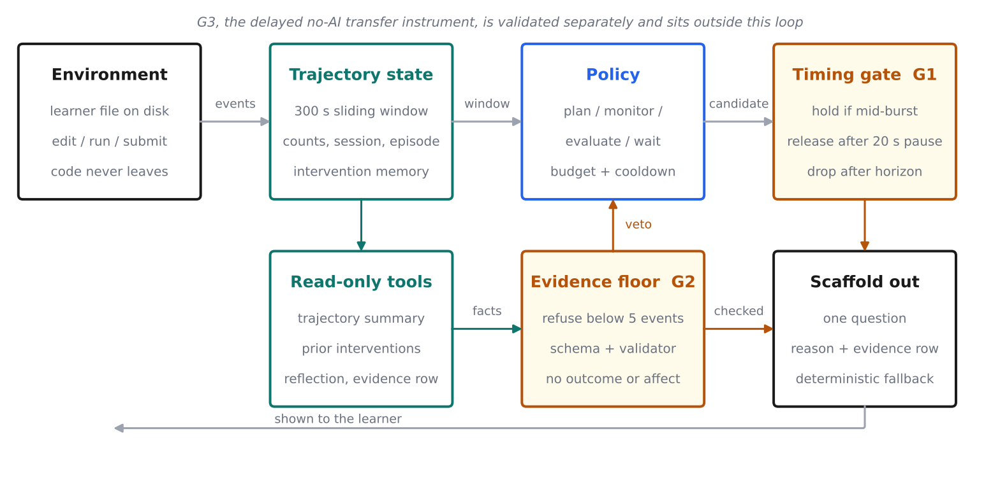

# TrajectoryCoach: Evidence-Grounded Metacognitive Scaffolding for Programming

**AI4015 Agentic Artificial Intelligence, Fall 2026 — Phase 2.** Project code **G3-11**.

| | |
|---|---|
| Group members | Minahil Kashif (23i-0554, group head), Areeba Javed (23i-0570) |
| Supervisor | Naeem Tareen |
| Seed | G3, *Implementing Trajectory-Informed Collaborative Agents for Gaining Metacognitive Skills in Programming* |
| Base paper | T. Phung, H. Choi, M. Wu, A. Singla, C. Brooks, *Plan More, Debug Less*, AIED 2025, [doi:10.1007/978-3-031-98414-3_1](https://doi.org/10.1007/978-3-031-98414-3_1) |

TrajectoryCoach watches a learner's IDE activity — edits, runs, focus changes,
submissions — and decides whether this is a good moment to ask one short
metacognitive question, or whether to stay quiet. It never sees the learner's
source code, never learns whether the code was correct, and never writes code.

**What this system is not.** Every result in this repository comes from
replaying logs recorded before this system existed, or from simulated learners. No student ever
saw a scaffold produced by this system. Nothing here is a learning outcome,
and no measure below is an effect of prompting.

---

## Architecture



| Stage | What it does |
|---|---|
| Environment | A real file on disk. Saves and runs become trajectory events. Source code never leaves the machine. |
| Trajectory state | A 300 s sliding window with counts, session and episode tracking, and a memory of recent interventions. |
| Policy | Chooses `plan`, `monitor`, `evaluate` or `wait`, under an episode budget, a response wait and a cooldown. |
| **Timing gate (G1)** | Holds a scaffold that would land inside a typing burst; releases it after 20 s of inactivity; drops it after the horizon. |
| **Evidence floor + validator (G2)** | Refuses to speak from a window below five events. A JSON schema, a validator and read-only tools keep generated wording inside the observed evidence. |
| Read-only tools | `get_trajectory_summary`, `get_prior_interventions`, `get_learner_reflection`, `check_evidence_row`, under a call budget. |
| Scaffold out | One question, the reason for it, and the evidence row it rests on. Falls back to deterministic wording if the model fails. |

**G3** is the delayed, no-AI transfer task and rubric. It sits outside the
runtime loop and is validated separately on simulated learners.

---

## Install and run

Python 3.10 or newer. The system, the offline experiments and the tests need
**no third-party packages**. `matplotlib` is needed only to redraw figures.

```bash
git clone https://github.com/Areeba444/TrajectoryCoach
cd TrajectoryCoach
python -m unittest discover -s tests -v        # 57 tests
```

### Use it on your own code

```bash
python -m coach.cli --file solution.py
```

The coach watches `solution.py`. Edit it in any editor; inside the session use
`run`, `submit`, `reflect <text>`, `state`, `quit`. The full trace is written
to `logs/session_<timestamp>.jsonl`.

To let a model word the scaffolds:

```bash
cp .env.example .env          # add your Groq key
python -m coach.cli --file solution.py --live
```

### Configuration

| Variable | Needed for | Default |
|---|---|---|
| `GROQ_API_KEY` | live model only | none; offline runs never read it |
| `GROQ_MODEL` | live model only | `openai/gpt-oss-20b` |

Keys are read from the environment only. `.env` is git-ignored and no key is
written to any file in this repository.

---

## Reproducing every experiment

```bash
python scripts/make_splits.py                  # data/splits.json
python -m scripts.run_experiments --split test # E1, E2, E3, E5, E6 offline
python -m scripts.run_transfer_study           # E4 / G3
python -m scripts.run_failure_analysis         # failure categories
python -m scripts.make_figures                 # figures/
python -m scripts.make_tables                  # paper/tables/
```

Live-model runs, which need network and a key:

```bash
python -m scripts.run_llm_experiments --smoke          # one call, checks the key
python -m scripts.run_llm_experiments --prefixes 100   # E4 / G2 and live E6
python -m scripts.run_llm_experiments --prefixes 100 --prompt-version v2 --sleep 3 --max-new 25
                                                       # prompt v2, in batches; rerun the same command to continue
python -m scripts.make_tables                          # refresh the tables
```

| Experiment | What it shows | Script | Output |
|---|---|---|---|
| E1 | Uncapped rule baseline | `run_experiments` | `results/phase2/experiments_test.json` |
| E2 | Base paper's on-demand policy on our data, 3 seeds | `run_experiments` | same file |
| E3 | Full proposed system | `run_experiments` | same file |
| E4 | One experiment per gap | `run_experiments`, `run_transfer_study`, `run_llm_experiments` | `experiments_test.json`, `e4_g3_transfer.json`, `e4_g2_grounding.json` |
| E5 | Ablation, one component removed at a time | `run_experiments` | `experiments_test.json` |
| E6 | Runtime, memory, tokens, latency, rejection rate | `run_experiments`, `run_llm_experiments` | both files |
| — | Failure categories and cases | `run_failure_analysis` | `results/phase2/failure_analysis.json` |
| — | Human rating, 30 scaffolds, two raters | `score_ratings` | `results/phase2/human_ratings.json` |

**Data split.** `data/splits.json` fixes it: learners sorted by identifier,
every third learner to test. Dev is 16 learners and 1,871,292 events; test is
8 learners and 726,897 events. The rule uses no outcome and was fixed
before any Phase 2 measurement. No threshold was tuned on the test learners,
but two design decisions were made after looking at test-split results: the
timing gate (added after the Phase 1 policy was measured interrupting more than
its own baseline) and the evidence floor (added after a failure analysis found
thin-evidence scaffolds). The Phase 1 defaults (cooldown, budget, window) were
also set while looking at all 24 learners. To check that this did not drive the
results, every offline experiment was rerun on the 16 dev learners
(`python -m scripts.run_experiments --split dev`, output
`results/phase2/experiments_dev.json`); the pattern holds there (see the devlog,
2026-11-11).

**Human rating.** Both authors rated 30 scaffolds from the full system
independently. Linearly weighted kappa is 0.328 for timing and 0.343 for
relevance, which is fair rather than strong agreement. The sheet showed raters
the phase and the prompt text but not when the scaffold was delivered, so the
timing column is reported for completeness and no claim rests on it.

**Agent traces.** `logs/*.jsonl` holds the delivered scaffolds for each
reported run (first 200 per condition), the flagged failure cases, and the
full tool-call traces from the live runs.

---

## Gap-resolution table

| Gap | Method / component | Metric | Base paper result | Our result | Addressed? | Caveat |
|---|---|---|---|---|---|---|
| Gap 1: timing | Timing gate: hold a scaffold until a 20 s pause | Interruption rate on held-out prefixes | 0.127 ± 0.014 (on-demand at pauses) | 0.021 | Partially | Ablating the gate raises interruption to 0.269; coverage falls against the uncapped baseline |
| Gap 2: grounding | Evidence floor, JSON schema, validator, read-only tools | Share of scaffolds containing an unsupported claim | 0.550 (unconstrained, same model) | 0.000 (v2); 0.140 (v1) | Fully | Deterministic screen, not a semantic verifier; v2 prompt written after v1 flags |
| Gap 3: transfer | Delayed no-AI transfer task and four-point rubric | Spearman r with latent skill, simulated learners | 0.724 (assisted completion) | 0.793 ± 0.036 | Partially | Instrument validation only; no human learners |

---

## Changes since Phase 1

| Change | Why |
|---|---|
| Fixed dev/test learner split | Phase 1 reported numbers on the same learners the thresholds were chosen on. Phase 1 and Phase 2 numbers are therefore not comparable. |
| Added the timing gate (G1 component) | Measurement showed the Phase 1 policy interrupted *more* per scaffold (0.657) than its own uncapped baseline (0.274). |
| Added the evidence floor (G2 component) | Failure analysis found 37.2% of scaffolds came from windows holding fewer than five events. |
| Base-paper comparator added | Phase 1 described an AIMS-inspired on-demand comparator but never implemented one. Three request models are now implemented; the pause model is the headline comparator because it is the strongest. |
| Educator raters replaced by log-derived timing measures | Two educator raters could not be recruited inside Phase 2. A small blind rating by the two authors is the only human check. |
| G3 scoped to instrument validation | The seven-day human study in Phase 1 is out of scope. The rubric is validated on simulated learners instead, which is a measurement claim only. |
| Groq instead of OpenAI | The group has a Groq key. The adapter targets the OpenAI-compatible endpoint; `coach/provider.py` keeps the original OpenAI path. |
| CLI instead of a VS Code extension | Phase 1 named a VS Code extension as the end product. The delivered interface is a session that watches a real file on disk. The event schema is unchanged, so an editor front end remains a drop-in. |

No written Phase 1 feedback was received from the supervisor, so none is
addressed here.

---

## Repository layout

```
coach/        agent, state, policy, gate, tools, provider, CLI
data/         Zenodo subset, provenance manifest, fixed split
docs/         evidence register, task specs, research gaps, development log
experiments/  experiment configuration
scripts/      split, experiments, transfer study, failure analysis, figures, tables
results/      saved results used in the paper
logs/         agent traces and failure cases
tests/        57 tests
paper/        LaTeX source and generated tables
figures/      generated figures
```

## Data and licence

IDE action logs from a CS1 MOOC, Juho Leinonen and Arto Hellas, Zenodo,
[doi:10.5281/zenodo.6903968](https://doi.org/10.5281/zenodo.6903968), CC BY
4.0. `data/manifest.json` records the subset, its hashes and its provenance.
The full source archive is about 1.36 GB; only the declared 24-learner prefix
is included. Code in this repository is MIT licensed; see `LICENSE`.
